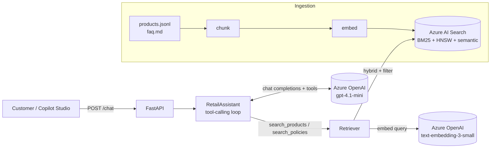

# Retail RAG Assistant — Azure OpenAI + Azure AI Search

A grounded customer assistant for a department store: it recommends products from a catalog and
answers customer-service questions (returns, shipping, payments, loyalty points) from an FAQ,
**citing the source document for every claim**. Built with Azure OpenAI (deployed through Azure AI
Foundry), Azure AI Search hybrid retrieval and an LLM tool-calling agent, served as a REST API.

> The store ("Vitrin"), its products and policies are **fictional demo data** in Turkish.

## What it shows

| Area | Implementation |
|---|---|
| RAG | Paragraph-aware chunking, Azure OpenAI embeddings, **hybrid search** (BM25 + HNSW vector, RRF fusion), optional **semantic ranker**, Turkish analyzer (`tr.microsoft`) |
| Agent / tool calling | LLM chooses between `search_products` (with category / gender / max-price filters → OData) and `search_policies`; multi-step loop with a step budget |
| Grounding | System prompt requires `[doc-id]` citations; ids never retrieved are dropped from the response |
| Integration | FastAPI `/chat` endpoint; its OpenAPI spec imports into **Copilot Studio / Power Automate** as a custom connector |
| LLMOps | Versioned prompt (`prompts/assistant.yaml`), per-request token usage + latency + prompt version, golden-set evaluation (recall@k, MRR), **LLM-as-judge** groundedness & relevance, CI quality gate |
| Engineering | Typed config (pydantic-settings), Protocol-based backends (Azure ↔ in-memory), 20 offline unit tests with a scripted fake LLM, Docker, GitHub Actions, Bicep IaC, keyless Entra ID auth supported |

## Architecture



```
src/retail_rag/
  documents.py       load + chunk catalog and FAQ
  embeddings.py      AzureOpenAIEmbedder, HashingEmbedder (offline)
  search_backend.py  AzureSearchBackend (index schema, hybrid query), InMemoryBackend
  retriever.py       embed → search
  agent.py           tools, tool-calling loop, citation extraction
  evaluation.py      recall@k, MRR, LLM judge
  api.py / cli.py    REST service and command line
infra/main.bicep     Azure AI Search + Azure OpenAI + model deployments
```

## Quick start (no Azure account needed)

```bash
uv venv && source .venv/bin/activate      # or python -m venv .venv
uv pip install -e ".[dev]"
pytest -q                                 # 20 tests, all offline
retail-rag eval-retrieval --offline       # recall@5 / MRR on the golden set
```

## Run against Azure

1. **Provision** (free Azure account credit is enough; Search `free` tier, pay-as-you-go tokens):
   ```bash
   az group create -n rg-retail-rag -l swedencentral
   az deployment group create -g rg-retail-rag -f infra/main.bicep -p prefix=<unique-name>
   ```
   Or create the same resources from the **Azure AI Foundry** portal: create a project, deploy
   `gpt-4.1-mini` and `text-embedding-3-small`, and add an Azure AI Search connection.
2. **Configure**: `cp .env.example .env` and fill in endpoints (keys optional — leave empty to use
   `az login` / managed identity).
3. **Index and ask**:
   ```bash
   retail-rag ingest
   retail-rag ask "Kışın sıcak tutan 7000 TL altı kadın montu önerir misin?"
   retail-rag ask "Kozmetik ürününü açtım, iade edebilir miyim?"
   ```
4. **Serve**:
   ```bash
   uvicorn retail_rag.api:app --reload      # http://localhost:8000/docs
   docker build -t retail-rag . && docker run --env-file .env -p 8000:8000 retail-rag
   ```

Example response (shape):

```json
{
  "answer": "Kuzey Kaz Tüyü Şişme Mont (6.499 TL) eksi 15 dereceye kadar sıcak tutar [p-005] ...",
  "citations": [{"id": "p-005", "title": "Kuzey Kaz Tüyü Şişme Mont", "source": "product"}],
  "tool_calls": [{"name": "search_products",
                  "arguments": {"query": "sıcak tutan kışlık mont", "gender": "kadin", "max_price": 7000},
                  "result_ids": ["p-005", "p-007", "p-008"]}],
  "usage": {"prompt_tokens": 1830, "completion_tokens": 96},
  "prompt_version": "1.0.0",
  "latency_ms": 2140
}
```

## Evaluation

```bash
retail-rag eval-retrieval -k 5 --min-recall 0.9   # retrieval quality gate (fails the build if below)
retail-rag eval --out reports/eval.json           # end-to-end: tool hit-rate, groundedness, relevance, latency, tokens
```

The golden set (`eval/golden.jsonl`) holds questions with the document ids that must be retrieved.
The end-to-end report records the prompt version, so a change to the prompt or model can be
compared run-to-run. CI runs the offline gate on every push; the Azure job runs when the
`RUN_AZURE_EVAL` repository variable and secrets are set.

**Retrieval** (15 golden questions, k=5)

| Backend | recall@5 | MRR |
|---|---|---|
| offline hashing baseline | 1.00 | 1.00 |
| Azure AI Search hybrid + `text-embedding-3-small` | 1.00 | 0.97 |

**End-to-end** (gpt-4.1-mini as agent and judge, mean of 2 runs per prompt version)

| Prompt | tool hit-rate | answers with citation | expected doc cited | groundedness (1-5) | relevance (1-5) | p50 latency | avg tokens |
|---|---|---|---|---|---|---|---|
| v1.0.0 | 0.93 | 0.87 | 0.87 | 4.97 | 5.00 | 4.2 s | 1,366 |
| v1.1.0 | **1.00** | **1.00** | **1.00** | 5.00 | 5.00 | 3.5 s | 1,651 |

What changed between versions (see the changelog in `prompts/assistant.yaml`):
the eval reports showed v1.0.0 (a) left `[id]` citations out of some product recommendations
and (b) once added a `gender: "unisex"` filter the customer never asked for, which hid the
right hiking boot and produced a false "we don't have it". v1.1.0 makes citations mandatory
and restricts filters to what the customer stated, at the cost of ~20% more prompt tokens.
With only 15 questions these numbers are a smoke test, not a benchmark.

## Copilot Studio integration

`/openapi.json` exposes a single `AskAssistant` operation. In Copilot Studio: *Tools → Add a tool →
REST API / custom connector*, import the spec (host the API on Azure Container Apps or App
Service), and call it from a topic so the copilot answers with the cited sources.

## Next steps

- Azure Functions blob trigger for incremental re-indexing when the catalog changes (event-driven)
- Tracing with `azure-monitor-opentelemetry` into Application Insights / Foundry tracing
- Azure AI Foundry evaluation SDK (`azure-ai-evaluation`) for built-in groundedness evaluators
- Conversation memory and query rewriting for multi-turn questions
