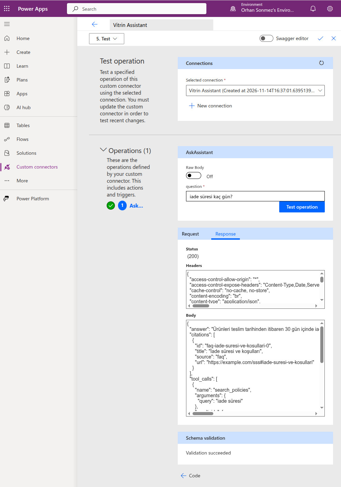

# Using the assistant from Microsoft Copilot Studio

The API is exposed to Copilot Studio through a **Power Platform custom connector** built
from `copilot/openapi-v2.yaml`. The copilot keeps the conversation; our API does the
retrieval, grounding and citation work.

## What was verified

| Step | Status |
|---|---|
| API on Azure Container Apps with `API_KEYS` | done |
| Custom connector imported from the Swagger file (host, API-key auth, `AskAssistant`) | done, definition validation succeeded |
| Connector test against the live API | **200**, grounded answer with its source, response schema validation succeeded |
| Copilot Studio agent with instructions and the connector as a tool | created |
| Chat test inside Copilot Studio | not run: the environment has no Copilot Credits (see below) |

## Prerequisites

- The API running on Azure Container Apps (see [deploy.md](deploy.md)) with `API_KEYS` set.
- A **Microsoft Entra work or school account**. Personal Microsoft accounts cannot sign in
  to Copilot Studio; a user created in the tenant that came with the Azure subscription
  (`...@<tenant>.onmicrosoft.com`) works.
- A Power Platform **environment with Dataverse**. The default environment of a new tenant
  has none ("Dataverse isn't set up in this environment"). The free
  [Power Apps Developer Plan](https://aka.ms/PowerAppsDevPlan) creates a Developer
  environment with Dataverse.
- **Copilot Credits** in that environment. The current Copilot Studio charges credits for
  testing an agent too, not only after publishing. A new tenant has none, and pay-as-you-go
  billing plans cannot be attached to Developer environments (only Production and Sandbox).
  Allocating credits needs the Power Platform Administrator role.

## Steps

1. **Connector file with the real host.** `copilot/openapi-v2.yaml` keeps a placeholder
   host; make a local copy (`copilot/*.local.yaml` / `*.local.json` are git-ignored) with
   `host:` set to the Container Apps FQDN. Some import dialogs accept JSON only.
2. **Create the custom connector** in [Power Apps](https://make.powerapps.com) (same
   environment as the agent) → *Custom connectors* (under *More → Discover all* if it is
   not in the menu) → *New custom connector* → *Import an OpenAPI file*. The Swagger file
   fills in everything:
   - General: scheme HTTPS, the host, base URL `/`
   - Security: API Key, parameter name `X-API-Key`, location Header
   - Definition: the `AskAssistant` action with its 200 / 401 / 429 / 503 / 504 responses

   Then *Create connector*.
3. **Test it** on the *Test* tab: *New connection* with one of the keys from `API_KEYS`, then
   run `AskAssistant` with a question such as "İade süresi kaç gün?". Expect status 200 and
   a citation of `faq-iade-suresi-ve-kosullari-0`.
4. **Create the agent** in [Copilot Studio](https://copilotstudio.microsoft.com) in the same
   environment (environment picker at the bottom left). Remove the default *Search all
   websites* knowledge source and the *Work IQ* tool so answers come only from the store
   data, and add instructions such as:
   > For any question about products, orders, returns, shipping, payment, loyalty points or
   > gift cards, call AskAssistant with the user's question and pass on its `answer`
   > unchanged, including the source tags. Do not answer these topics from your own
   > knowledge. Reply in the user's language.
5. **Add the tool**: *Tools → +* → *Connectors* tab → search for the connector → select
   `AskAssistant` and the connection from step 3. (The current Copilot Studio no longer
   offers a direct "REST API" tool; *Add* only shows MCP and Workflow, so the custom
   connector is the way in.)
6. **Test** in *Preview* once the environment has credits: "Kozmetik ürününü açtım, iade
   edebilir miyim?" should produce a tool call and an answer citing
   `faq-iade-suresi-ve-kosullari-0`.

## Notes

- Swagger 2.0 is used because Power Platform custom connectors are defined in that format.
  FastAPI's own `/openapi.json` (OpenAPI 3) is still available for other clients.
- The `blocked` flag lets a topic branch to a hand-off message when a request was refused.
- Rate limits (HTTP 429) are per API key; give the copilot connection its own key.
